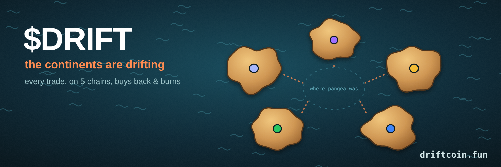

  

<h1 align="center">$DRIFT</h1>

  <b>One coin on five chains. Every trade buys back and burns it.</b> 
  Live burn tracker → <a href="https://driftcoin.fun"><b>driftcoin.fun</b></a> · <a href="https://x.com/driftcoinpangea">@driftcoinpangea</a>

  
  
  
  

---

## What is $DRIFT?

Pangea was one supercontinent. Then it drifted apart.

**$DRIFT** launched on [Pangea](https://www.pangea.trade) on all five of its chains at once. Each chain is a continent. Every trade on any chain pays a 1% fee, and **half of the creator's share is automatically spent buying $DRIFT and burning it**, on that chain, about every 15 minutes. The more a chain trades, the further its continent drifts.

| | |
|---|---|
| **Chains** | Solana · BSC · Base · Robinhood Chain · Ethereum |
| **Trading fee** | 1%, fixed at launch |
| **Burn** | 50% of the creator fee share → buy & burn, enforced by Pangea's on-chain vault |
| **Dev allocation** | None: all supply went into the pools at launch |
| **Liquidity** | Locked on every chain |
| **Contract (Solana)** | `21psrnKxvmHHgALv8vM4imTv79fpB6fL98GAK7mdC6ea` |
| **Contract (EVM: ETH · Base · BSC · Robinhood)** | `0x36a0ff21ED15388dBBCCf3E3E9C52b0F643FE6EA` |

## The live tracker

[**driftcoin.fun**](https://driftcoin.fun) shows, live:

- 🔥 total DRIFT burned and % of supply
- 🌍 a map where each chain's continent drifts further out as it burns more
- 📈 burns over time
- 📊 per-chain burns, 24h volume and price

## Open and checkable

Everything on the site comes straight from Pangea's public data. Nothing is typed in by hand.

- [`fetch.mjs`](fetch.mjs) reads Pangea every ~10 minutes ([`.github/workflows/update.yml`](.github/workflows/update.yml))
- the raw numbers are committed to [`data/`](data), so every update is in the commit history
- burns can be checked on-chain on each chain's explorer

## Links

- 🌐 Site: https://driftcoin.fun
- 𝕏 X: https://x.com/driftcoinpangea
- 🌍 Pangea: https://www.pangea.trade/app/t/0x36a0ff21ED15388dBBCCf3E3E9C52b0F643FE6EA

Not financial advice. Memecoins are risky and can go to zero.
